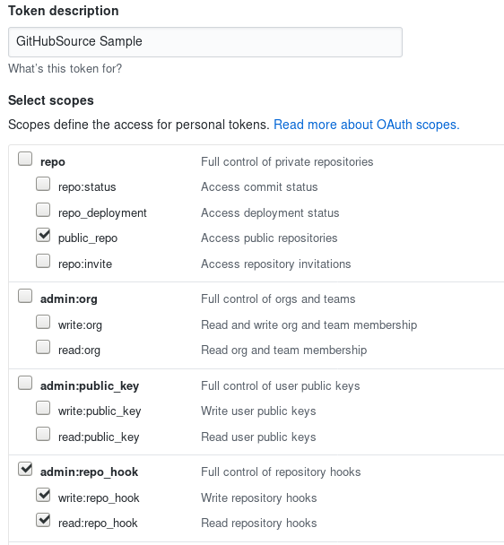
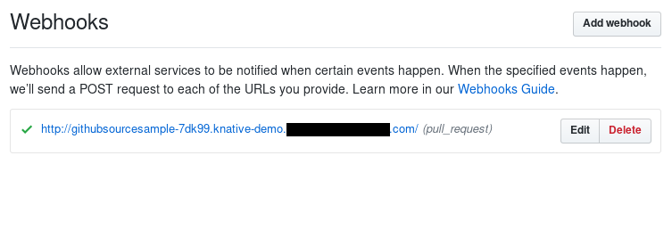

# GitHub source

GitHub Source example shows how to wire GitHub events for consumption
by a Knative Service.

## Get the sample files

Clone the repository and run the commands below from this sample directory:

```bash
git clone https://github.com/knative/docs.git knative-docs
cd knative-docs/code-samples/eventing/github-source
```

## Before you begin

1. Set up [Knative Serving](https://knative.dev/docs/install/serving/install-serving-with-yaml).
1. Ensure Knative Serving is [configured with a domain name](https://knative.dev/docs/serving/using-a-custom-domain) that allows GitHub to call into the cluster.
1. You must ensure that your Knative cluster uses a static IP address refer to your provider's documentation.
1. Set up [Knative Eventing](https://knative.dev/docs/install/eventing/install-eventing-with-yaml).

### Install GitHub Event Source

GitHub Event source lives in [knative-extensions/eventing-github](https://github.com/knative-extensions/eventing-github). Head to the releases page, find the latest release with the `github.yaml`
artifact and replace  `<RELEASE>` with the version tag:

```bash
kubectl apply -f https://github.com/knative-extensions/eventing-github/releases/download/<RELEASE>/github.yaml
```

Check that the manager is running:

```bash
kubectl -n knative-sources get pods --selector control-plane=github-controller-manager
```


### Create a Knative Service

To verify the GitHub source is working, create a simple Knative
Service that dumps incoming messages to its log.
[service.yaml](service.yaml) defines this Service using the Eventing
`event_display` receiver image.

Enter the following command to create the service from `service.yaml`:

```bash
kubectl --namespace default apply --filename service.yaml
```

### Create GitHub Tokens

Create a [personal access token](https://github.com/settings/tokens)
for GitHub that the GitHub source can use to register webhooks with
the GitHub API. Also decide on a secret token that your code will use
to authenticate the incoming webhooks from GitHub (_secretToken_).

The token can be named anything you find convenient. The Source
requires `repo:public_repo` and `admin:repo_hook`, to let it fire
events from your public repositories and to create webhooks for those
repositories. Copy and save this token; GitHub will force you to
generate it again if misplaced.

Here's an example for a token named "GitHubSource Sample" with the
recommended scopes:



Update [githubsecret.yaml](githubsecret.yaml) with those values: set
`stringData.accessToken` to your generated access token and
`stringData.secretToken` to your chosen webhook secret. Keep the secret name
and keys unchanged because the source references them. Do not commit real tokens.

Hint: you can makeup a random _secretToken_ with:

```bash
head -c 8 /dev/urandom | base64
```

Then, apply the githubsecret using `kubectl`:

```bash
kubectl --namespace default apply --filename githubsecret.yaml
```

### Create Event Source for GitHub Events

In order to receive GitHub events, you have to create a concrete Event
Source for a specific namespace. Be sure to replace the
`ownerAndRepository` value with a valid GitHub public repository owned
by your GitHub user.

Edit [github-source.yaml](github-source.yaml), which subscribes to
`pull_request` events, references the token Secret, and sends events to
`github-message-dumper`.

If using GitHub Enterprise, add `spec.githubAPIURL` with your enterprise API
endpoint, for example `https://github.mycompany.com/api/v3/`.

Then, apply the file using `kubectl`:

```bash
kubectl --namespace default apply --filename github-source.yaml
```

### Verify

Verify the GitHub webhook was created by looking at the list of
webhooks under the Settings tab in your GitHub repository. A hook
should be listed that points to your Knative cluster with a green
check mark to the left of the hook URL, as shown in the following image:



### Create Events

Create a pull request in your GitHub repository. We will verify
that the GitHub events were sent into the Knative eventing system
by looking at our message dumper function logs.

```bash
kubectl --namespace default get pods -l serving.knative.dev/service=github-message-dumper
kubectl --namespace default logs -l serving.knative.dev/service=github-message-dumper -c user-container --tail=50
```

You should see a CloudEvent similar to the following (IDs, source, and payload
will depend on your repository and pull request):

```text
☁️  cloudevents.Event
Context Attributes,
  specversion: 1.0
  type: dev.knative.source.github.pull_request
  source: https://github.com/someuser/somerepo
  id: a8d4cf20-e383-11e8-8069-46e3c8ad2b4d
  datacontenttype: application/json
Data,
  {
    "action": "opened",
    "number": 1,
    "pull_request": { ... }
  }
```

### Cleanup

You can remove the Github webhook by deleting the Github source:

```bash
kubectl --namespace default delete --filename github-source.yaml
```

Similarly, you can remove the Service and Secret via:

```bash
kubectl --namespace default delete --filename service.yaml
kubectl --namespace default delete --filename githubsecret.yaml

```
