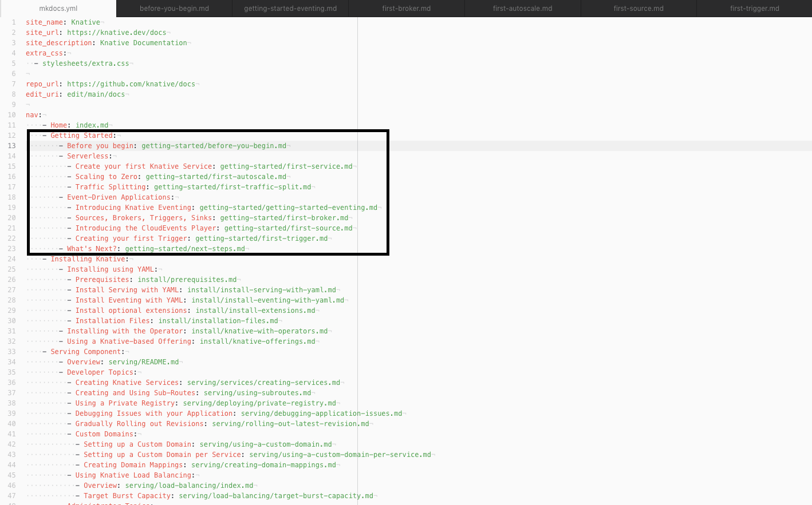
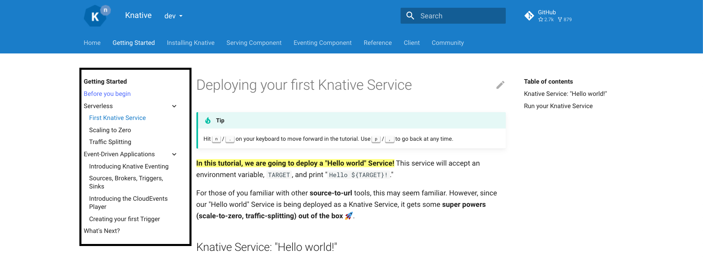

# Editing the website navigation and redirects

## Navigation

Edit [`docs/versioned/.nav.yml`](../../docs/versioned/.nav.yml) for the current technical documentation. Other published collections have their own `.nav.yml` files under `docs/`. The local preview and release build assemble the top-level navigation; `config/nav.yml` is a legacy location, not the current source.

When adding a destination, include its source path, page title, reader purpose, and proposed entry links in the PR. Navigation labels and link descriptions should promise what the destination actually provides. Keep component context; do not add empty mode collections or copy a page to make it appear in several routes.

These screenshots illustrate the navigation format and appearance; their paths and labels may reflect an older layout.

The backend looks as follows:



The frontend looks as follows:



For more in-depth information on navigation, see:
[Configure Pages and Navigation](https://www.mkdocs.org/user-guide/writing-your-docs/#configure-pages-and-navigation)
in the MkDocs documentation and
[Setting up Navigation](https://squidfunk.github.io/mkdocs-material/setup/setting-up-navigation/)
in the Material for MkDocs documentation.

### Redirects

The Knative site uses [mkdocs-redirects](https://github.com/datarobot/mkdocs-redirects)
to redirect users from a page that may no longer exist (or has been moved) to their desired location.

Adding redirects to the Knative site is done in one centralized place,
[`/config/redirects.yml`](../../config/redirects.yml).
Use source paths relative to `docs/`, including the `.md` extension. For example:

```yaml
plugins:
  redirects:
    redirect_maps:
      versioned/old-guide.md: versioned/new-guide.md
```

Retain an existing URL when the page can remain a useful entry point. If you move a page, update navigation and incoming links as well as the redirect. A page redirect alone does not restore a removed fragment: preserve old heading IDs or add explicit anchors in the destination, then check old URLs and fragments in the rendered preview. The local preview maps `versioned/` source paths to `/docs/`; release assembly also supplies version-specific routes.

Contributor guidance under `contribute-to-docs/` is read on GitHub, not automatically published by MkDocs. Link new contributor pages from the [contributor guide](../README.md) or [template index](../templates/README.md) and check them in that context.
