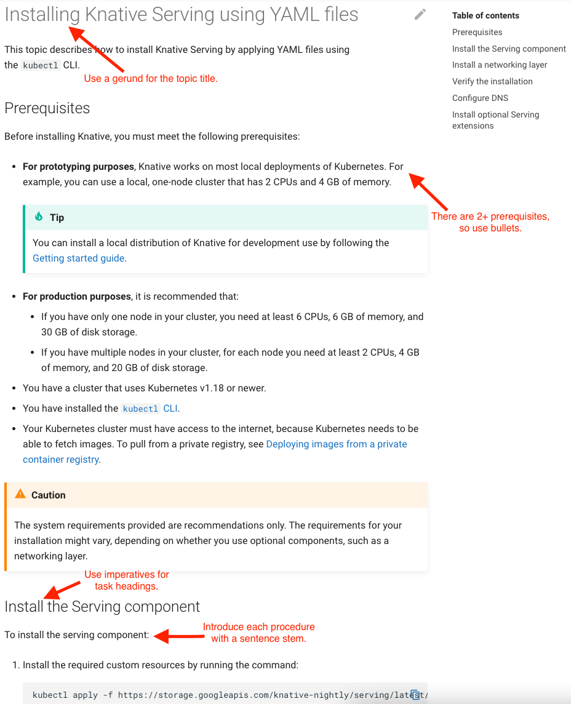

<a id="procedure-template"></a>

# How-to guide template

Use this template for a reader who has a specific goal, not for a first learning experience or a settings catalog. The legacy Procedure filename is retained for existing links.

Contract: one bounded goal, sufficient prerequisites, necessary actions, and verification. Include recovery for risky changes; link to detailed explanation and reference. Review with the [page checklists](../what-to-contribute/creating-new-docs.md#author-and-reviewer-checklists).


## Template

Copy the following scaffold and replace the author prompts. Metadata applies to versioned technical pages; use the appropriate audience and only the components involved. Omit inapplicable recovery or cleanup sections, not verification.

```
---
audience: developer
components:
  - eventing
function: how-to
---

# Accomplish a specific goal

State the goal, scope, and resulting state. Say when this guide applies and link
to background knowledge instead of requiring a conceptual detour.


## Prerequisites

List the starting resources, components, tools, permissions, and version or
feature requirements. Link to their setup rather than embedding a new setup
catalog. Explain placeholders and namespace assumptions before using them.

For example, configuring an Apache Kafka Broker needs an installed Eventing
component and access to a Kafka cluster, plus the implementation-specific
prerequisites. State those requirements precisely for the guide's scope.

For risky changes, require a recoverable copy of the authoritative configuration.

## Perform the task

Use a goal-oriented heading instead of a generic "Task 1" in the finished page.
Give a numbered sequence and complete commands with consistent resource names.
If necessary steps form several phases of the same goal, add descriptive
headings. Do not invent extra steps just to make a single-step task longer.

1. Step 1: inspect or prepare the existing resource.
1. Step 2: make and apply the intended change.

Keep only short context needed to choose or execute the steps. Move a distinct
optional goal to its own guide rather than extending this page indefinitely.


## Verify the result

Give the command or observation that proves the intended result, with expected
output or status. Distinguish resource readiness from end-to-end behavior.
If the check fails, link to a relevant symptom-led troubleshooting path.

## Recover or clean up

For risky changes, explain how to restore the previous configuration. Identify
which resources are safe to delete, and warn before destructive actions.

## Related information

Link to the authoritative settings reference and supporting explanation.
Keep optional goals in separate guides when they change the page's purpose.
```

## Procedure content samples

This section provides common content types that appear in procedural topics.
Copy and paste the markdown to use it in your topic.


### Markdown embedded image

The following is an embedded image reference in markdown.

```

```


### Tables

Introduce the table with a sentence. For example, “The following table lists which operations must be
made available to a developer accessing a Knative Route using a minimal profile.”


#### Markdown table template

```
|Header 1|Header 2|
|--------|--------|
|Data1   |Data2   |
|Data3   |Data4   |
```

#### “Fill-in-the-Fields” table

Where the reader must enter many values in, for example, a YAML file, use a table within the
procedure as follows:

    1. Open the YAML file.

        ```yaml
        Key1: Value1
        Key2: Value2
        metadata:
          annotations:
            # case-sensitive
            Key3: Value3
          Key4: Value4
          Key5: Value5
        spec:
          # Configuration specific to this broker.
          config:
            Key6: Value6
        ```

    2. Change the relevant values to your needs, using the following table as a guide.

        | Value   | Value Type     | Description  |
        |---------|----------------|--------------|
        | Value1  | String         | Description  |
        | Value2  | Integer        | Description  |
        | Value3  | String         | Description  |
        | Value4  | String         | Description  |
        | Value5  | Float          | Description  |
        | Value6  | String         | Description  |


### Ordered lists

Write a sentence or two to introduce the content of the list.
For example, “If you want to fix or add content to a past release, you can find the source files in
the following folders.”. Optionally, include bold lead-ins before each list item.

**NOTE:** For the formatting to render correctly, you must add an empty line
between the list and the preceding sentence.

#### Markdown ordered list template

```
Introductory sentence:

1. Item 1
1. Item 2
1. Item 3
```

```
Introductory sentence:

1. **Lead-in description:** Item 1
1. **Lead-in description:** Item 2
1. **Lead-in description:** Item 3
```

#### Nested ordered lists template

For formatting to render correctly, nested items must be indented by four spaces
in relation to their parent item.

```
Introductory sentence:

1. Item 1

    1. Item 1a

1. Item 2
```

### Unordered Lists

Write a sentence or two to introduce the content of the list.
For example, “Your own path to becoming a Knative contributor can begin in any of the following
components:”. Optionally, include bold lead-ins before each list item.

**NOTE:** For the formatting to render correctly, you must add an empty line
between the list and the preceding sentence.

#### Markdown unordered list template

```
Introductory sentence:

* List item
* List item
* List item
```

```
Introductory sentence:

* **Lead-in**: List item
* **Lead-in**: List item
* **Lead-in**: List item
```

#### Nested unordered list template

Nested items must be indented by four spaces in relation to their parent item.

```
Introductory sentence:

* List item

    * List sub-item

* List item
```

### Notes

Ensure the text beneath the **note** is indented as much as **note** is.

```
!!! note
    This is a note.
```

### Warnings

If the note regards an issue that could lead to data loss, the note should be a warning.

```
!!! warning
    This is a warning.
```

### Tabs

A how-to may offer complete equivalent workflows (such as `kn` CLI and YAML) in tabs. A tutorial should choose one main route and move alternatives out of its required path. Indent tab content four spaces and keep commands consistent throughout each workflow.

    === "tab1 name"

        This is a stem:

        1. This is a step.

          ```
          This is some code.
          ```

        1. This is another step.

    === "tab2 name"

        This is a stem:

        1. This is a step.

          ```
          This is some code.
          ```

        1. This is another step.


### Documenting code and code snippets

For instructions on how to format code and code snippets, see the [Style guide](../style-guide/documenting-code.md).
