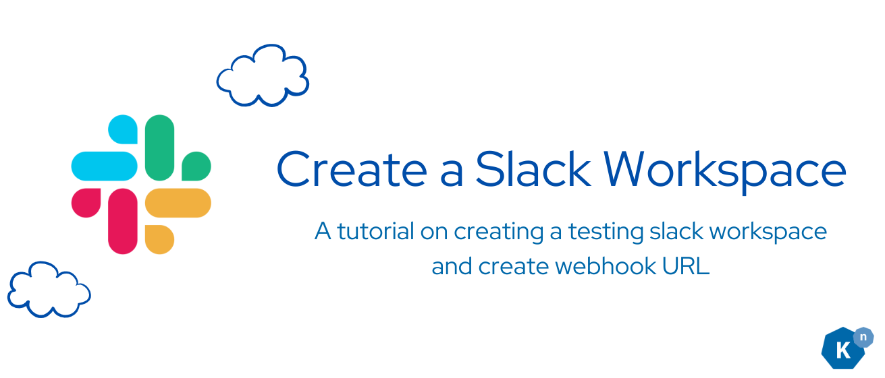
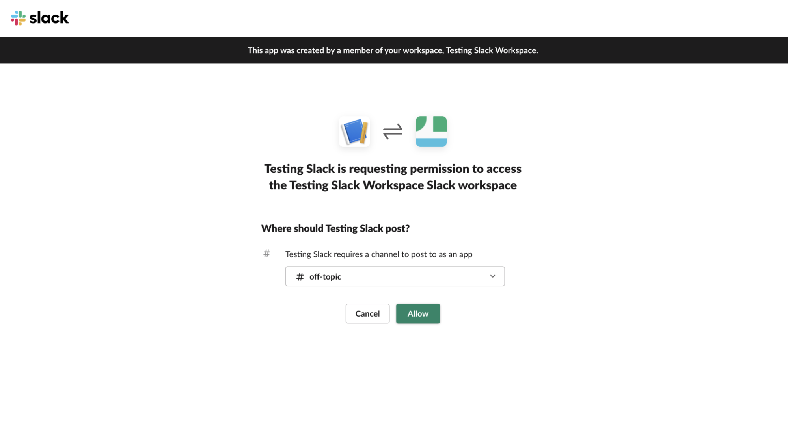
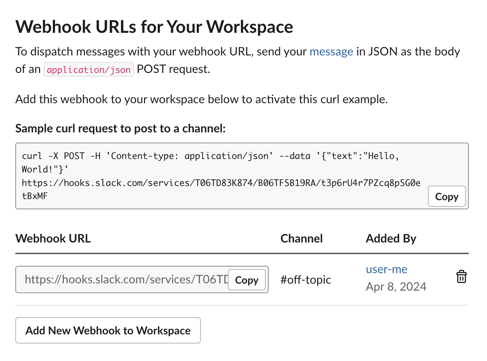
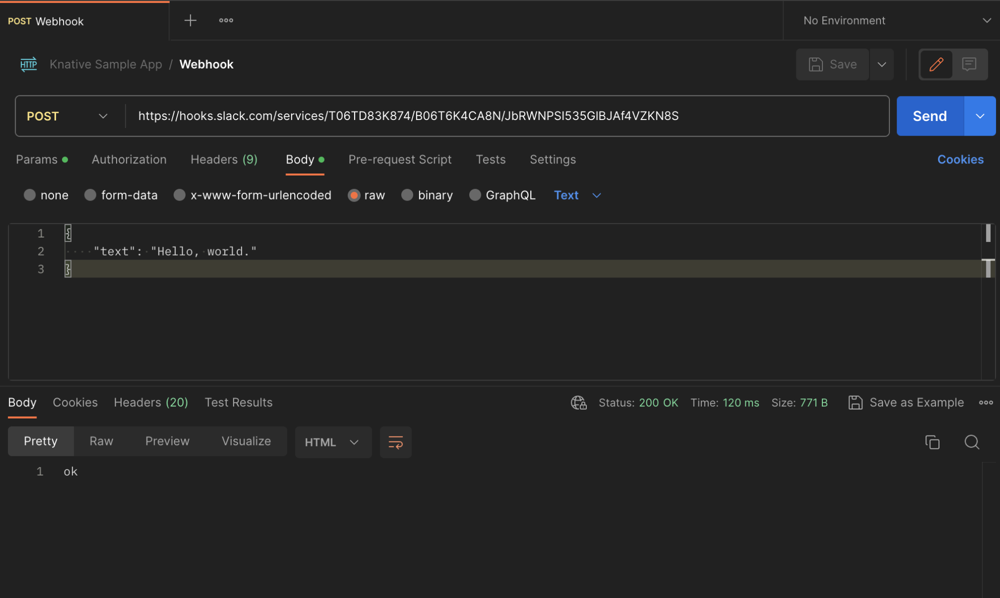
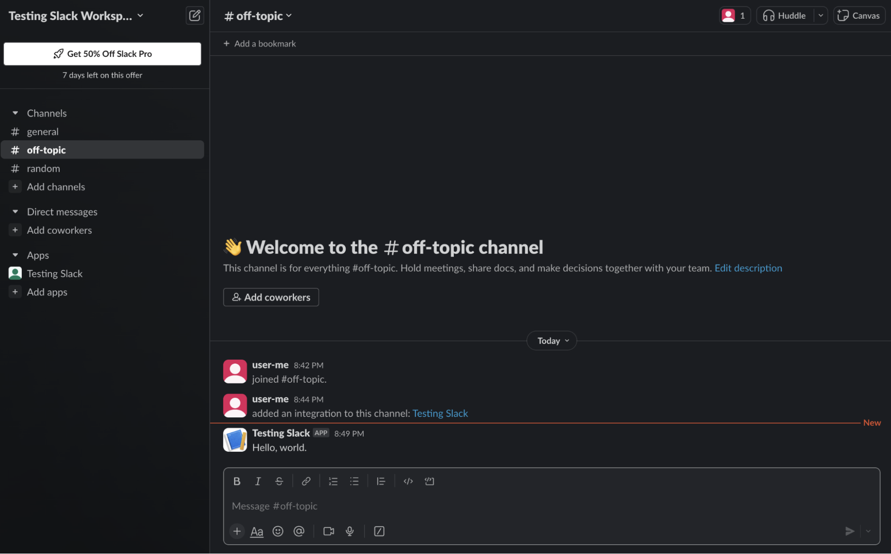

# Creating a Slack Workspace

This helper is only needed for the [optional Bookstore Slack extension](../page-7/slack-sink-learning-knative-eventing-and-apache-camel-K-integration.md). You need a Slack account and permission to create an app and incoming webhook in the target workspace. If you already have a workspace, skip directly to [webhook setup](#setting-up-a-webhook-for-notifications).

To create a Slack workspace, follow these steps:

1. Visit [https://slack.com/get-started#/createnew](https://slack.com/get-started#/createnew){:target="_blank"}.
2. Enter your email address and click Continue, or continue with Apple or Google.
3. Check your email for a confirmation code.
4. Enter the code on the Slack website.
5. Click "Create a Workspace" and follow the prompts.
6. For detailed instructions how to create a workspace via the Desktop App, Android or iOS, refer to [Create a Slack workspace](https://slack.com/help/articles/206845317-Create-a-Slack-workspace){:target="_blank"}.

## **Adding Channels to Your Workspace**

After creating your Slack workspace, you can add channels by following these steps:

1. Click the '+' icon next to 'Channels' on the sidebar of your Slack workspace.
2. Choose "Create a channel" and specify the channel name and purpose.
3. For enterprise grid organizations, refer to [Slack's help article](https://slack.com/help/articles/115001399587-Add-a-channel-to-multiple-workspaces-in-your-Enterprise-Grid-organization){:target="_blank"} for instructions.

## **Setting Up a Webhook for Notifications**

To set up a webhook for sending notifications to your Slack workspace:

- 1: Create a [Slack app](https://api.slack.com/apps/new){:target="_blank"}, following the instructions by signing in, adding name and workspace to put the app in.

- 2: After this, you'll be redirected to the setting pages of your new app. Choose Incoming Webhook and toggle Activate Webhook.

- 3: Scroll down to click the option Add New Webhook to Workspace.

- 4: The page will give you a link associated with the app you created. This link will be where API requests are sent to send messages to your Slack workspace.

- 5: To test if the webhook works as needed, you can try sending an API request to this link to see if the message goes through. I used Postman to test this. Send a JSON request body with the `Content-Type: application/json` header; use the example in [Slack's webhook documentation](https://api.slack.com/messaging/webhooks).

- 6: Afterwards, the text channel should have a new message.

- 7: Go to [Slack's webhook documentation](https://api.slack.com/messaging/webhooks){:target="_blank"} to learn more about setting up webhooks.

Treat the webhook URL as a credential. Do not commit it or share it in logs or support requests. After the test message appears in the intended channel, [return to the extension's credential setup](../page-7/slack-sink-learning-knative-eventing-and-apache-camel-K-integration.md#prerequisite-3-create-a-secret-that-stores-your-slack-credentials).