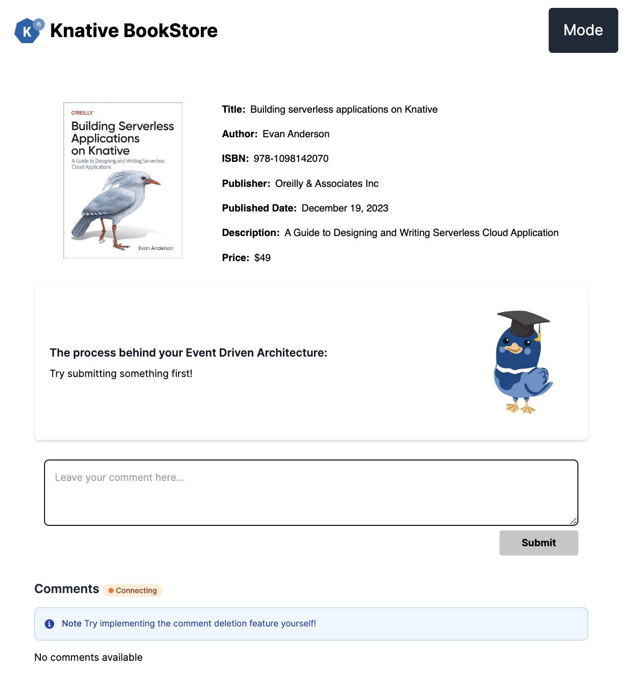
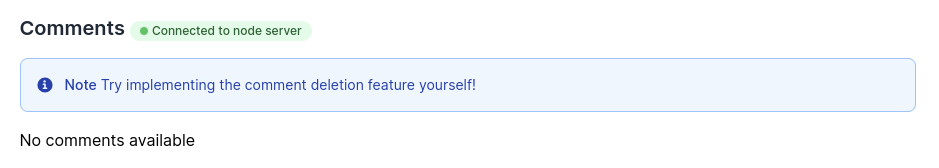

# Environment Setup

**Starting state:** You have read the [Bookstore overview and prerequisites](../page-0/welcome-knative-bookstore-tutorial.md#before-you-begin). Use a disposable **kind Quickstart cluster**, the **published frontend/backend images**, and the **manual commands below**. Other environments and the setup script are [optional alternatives](setup-options.md), not steps in this route.

<span id="what-does-the-final-deliverable-for-this-section-look-like"></span>

By the end of this lesson, the frontend opens in your browser and connects to the Node.js review service. The database and event-processing path are not connected yet.

## Clone the Repository

```sh
git clone https://github.com/knative/docs.git
cd docs/code-samples/eventing/bookstore-sample-app/start
```

If you already have a checkout, use its `code-samples/eventing/bookstore-sample-app/start` directory instead. The first `docs` in the command is the repository directory, not the website's `docs/` content directory.

[Troubleshoot cloning errors](https://docs.github.com/en/repositories/creating-and-managing-repositories/troubleshooting-cloning-errors) if needed. Review the [disclaimer and third-party licenses](../disclaimer/README.md) before using the sample.

## File Structure

The sample app has two directories:

- `start`: supplied source and initial configuration. Create your lesson YAML files here.
- `solution`: completed configuration and function code for comparison when stuck.

**All commands are run from `start` unless the lesson explicitly enters a function project.** Save that location in your terminal so you can return to it:

```sh
export BOOKSTORE_START="$PWD"
pwd
```

Keep this terminal for the lesson commands. New terminals need to enter the same directory; `BOOKSTORE_START` is not automatically shared between terminals.

## Shortcut

The [setup-script notes](setup-options.md#setup-script) explain the retained script's prerequisites and installation changes. It is not equivalent to the chosen route; continue with the manual instructions below rather than running it over your Quickstart cluster.

## Instructions

### Task 1: Set Up a Running Kubernetes Cluster with Knative Installed

Reuse the cluster from [Quickstart installation](../../getting-started/quickstart-install.md). If you deleted it, recreate it with that lesson's `kn quickstart kind` instructions. Do not run the Bookstore setup script over it; that script applies separate latest-release installations.

Check your context before applying resources:

```sh
kubectl config current-context
kubectl config set-context --current --namespace=default
kubectl get pods -n knative-serving
kubectl get pods -n knative-eventing
kubectl get crd sequences.flows.knative.dev inmemorychannels.messaging.knative.dev
```

The context should be your disposable Quickstart cluster, normally `kind-knative`. Switch to it if necessary. Wait for Serving and Eventing pods to be Ready. The two CRDs must exist for the later Sequence lesson; if absent, resolve the Eventing installation before proceeding.

Install and run the [kind LoadBalancer provider](https://kind.sigs.k8s.io/docs/user/loadbalancer/) using kind's instructions, including its host/container-runtime permissions. Keep the provider running while accessing this sample. This is **additional** to Quickstart's Kourier ingress: the frontend and backend below are ordinary Kubernetes LoadBalancer Services.

### Task 2: Running the Bookstore Web App

#### Deploy the Frontend App

Use the pre-built image already specified in the supplied YAML; there is no image-build step in this route.

```sh
kubectl apply -f frontend/config/100-front-end-deployment.yaml
kubectl rollout status deployment/bookstore-frontend --timeout=300s
```

!!! success "Expected result"
    Kubernetes creates `deployment.apps/bookstore-frontend` and `service/bookstore-frontend-svc`. The Deployment rollout completes. Generated pod names vary.

#### Access the frontend workload

```sh
kubectl get service bookstore-frontend-svc
```

Wait for an `EXTERNAL-IP`, then open `http://<EXTERNAL-IP>` in your browser. Use the address from your output, not one copied from a screenshot.

!!! success "Verify"
    The bookstore page appears. It does not yet have a running backend or database.

    

If `EXTERNAL-IP` stays `<pending>`, check that the kind LoadBalancer provider is running and consult its [troubleshooting instructions](https://kind.sigs.k8s.io/docs/user/loadbalancer/). Quickstart ingress being reachable is not sufficient evidence that these Services have external addresses.

### Task 3: Running the Book Review Service

#### Deploy the Book Review Service: Node.js Server

Use the pre-built Node.js image from the supplied configuration:

```sh
kubectl apply -f node-server/config/100-deployment.yaml
kubectl rollout status deployment/node-server --timeout=300s
kubectl get service node-server-svc
```

!!! success "Expected result"
    Kubernetes creates `deployment.apps/node-server` and `service/node-server-svc`, and the Deployment rollout completes.

#### Access the node server backend

Wait for the backend's `EXTERNAL-IP` and open `http://<EXTERNAL-IP>`. The backend root endpoint returns `Hello, world!`, not a bookstore UI.

Return to the frontend. Its connection indicator should turn green and say **Connected to node server**. The frontend proxies backend requests using `node-server-svc` in the pod's namespace; the backend uses `postgresql.default.svc.cluster.local`, so keep this exercise in `default`.



The backend tries to read database comments before you deploy PostgreSQL. Database connection/query errors and the absence of comments are expected at this stage; the connection indicator is not proof that the database is ready. Do not submit reviews yet: the Broker and SinkBinding are created in the next lesson.

## Troubleshooting

If a rollout fails, inspect status and logs rather than proceeding:

```sh
kubectl get pods
kubectl describe deployment bookstore-frontend
kubectl describe deployment node-server
kubectl logs deployment/bookstore-frontend
kubectl logs deployment/node-server
```

For an individual pod, use `kubectl logs <pod-name>` with its actual name. Check image-pull errors and container startup failures. For a pending external address, check the LoadBalancer provider, not only the application logs.

## Next Step

Proceed only when the frontend opens, the backend responds, and the frontend shows a backend connection.

**Previous:** [Bookstore overview](../page-0/welcome-knative-bookstore-tutorial.md) · **Next:** [Send a review to the Broker](../page-1/send-review-comment-to-broker.md)
