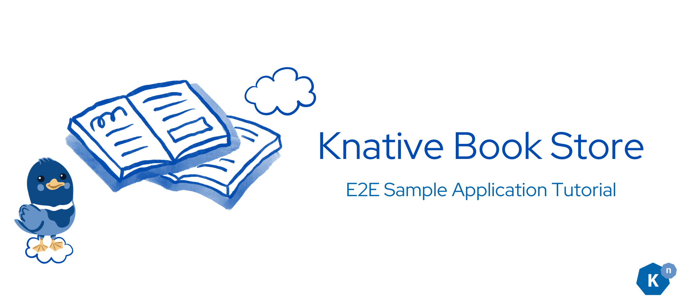
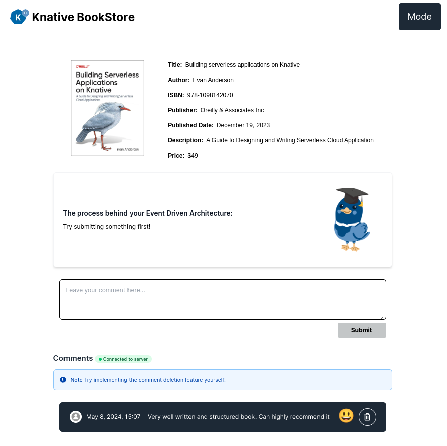
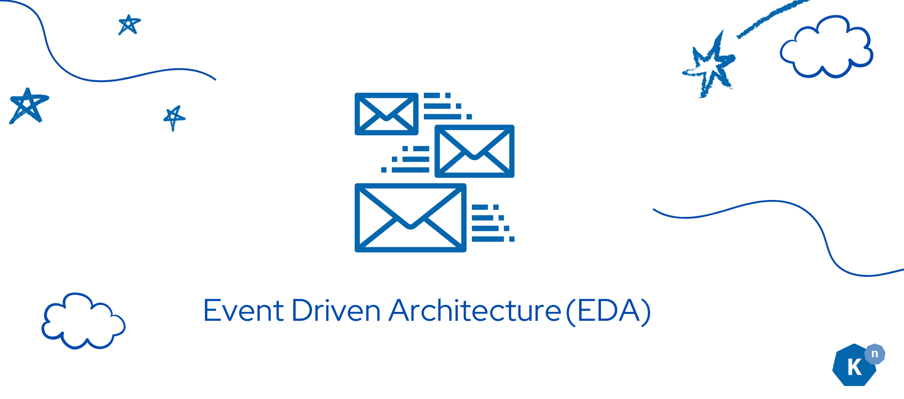
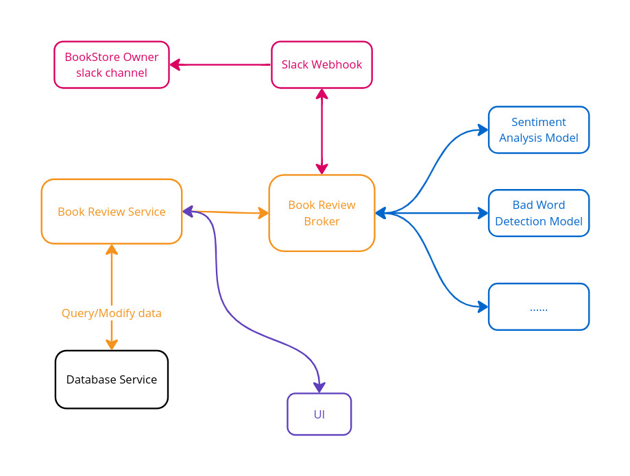
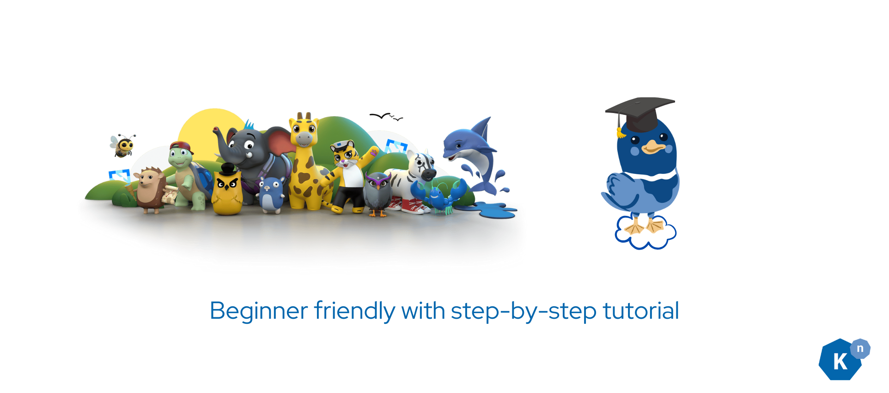
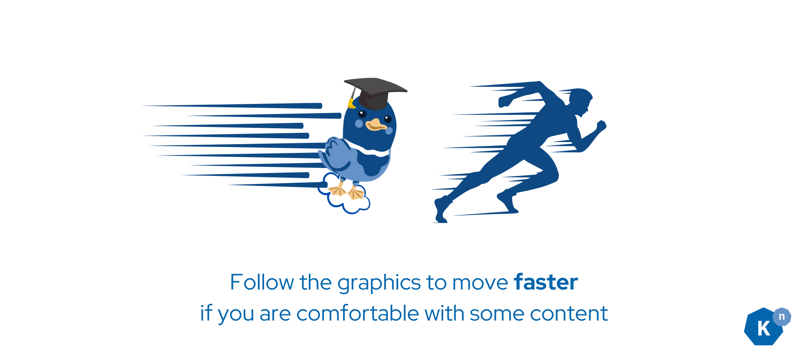
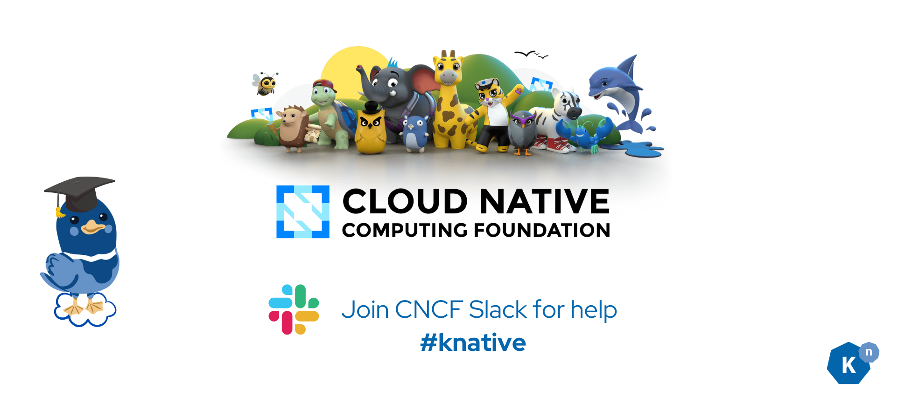
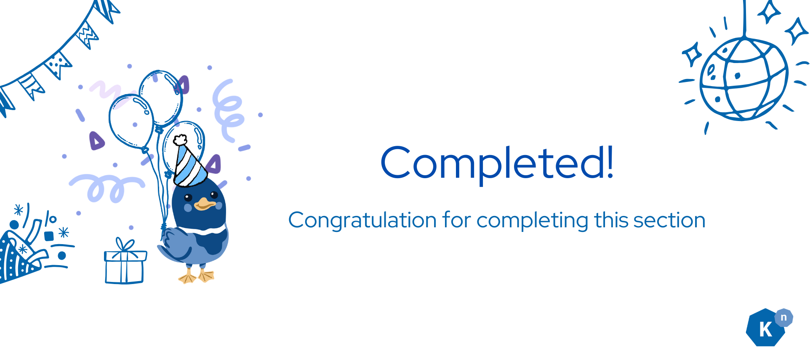

# Knative Bookstore tutorial

Build a larger sample application that combines Functions, Serving, and Eventing.
The lessons follow reviews through an event-processing workflow and add the web
application, processing services, and database around it.

If you are new to Knative, begin with the independent [Get Started tracks](../../README.md)
first. Bookstore is a follow-on application exercise, not another universal
introduction, a migration guide, or a production bookstore. You can reuse your
learning cluster; the [environment setup](../page-0.5/environment-setup.md) describes
the extra application resources.

## **What are we building?**

Our App is an online bookstore that sells a single book. Customers can post comments about the book anonymously, with each comment displayed alongside an emoji reflecting the sentiment of the comment. Comments with inappropriate content are automatically filtered out, discarded, and logged in the backend.

As the bookstore owner, you'll receive notifications via Slack each time if a comment containing a "bad word" is submitted.

## **Learning Goal**

Follow a concrete event-driven application from its producer to its consumers:

- Send review comments to a Broker and route them using Triggers.
- Connect processing functions in a Sequence to analyze and filter reviews.
- Store processed reviews and display them in the web application.
- Explore an external notification integration in the later Slack/Camel K lesson.

Reuse a ready learning cluster or create one through the shared setup guide.
The application adds its own frontend, backend, processing services, and database;
the introductory tracks do not create those resources for you.

## **Bookstore Architecture**

The bookstore application consists of the following components:

### User Interface

A frontend Next.js application that interacts with these services. It is a web page where users can select a book to view its details, ratings and reviews.

### Database Service

An in-memory PostgreSQL instance on Kubernetes, storing all user comments.

### Book Reviews Service

A Node.js web server that will perform the event forwarding, database operation, and handling the websocket connection.

### Notification Service

An Apache Camel K pipe that connects our event-driven architecture with a third-party webhook: Slack. It receives the CloudEvent and sends it as a message to a Slack Workspace.

### ML Models Service

There are 2 Machine learning workflows that can conduct sentiment analysis on user's review comment and hateful word sanity check. You will be using a [Knative Sequence](https://knative.dev/docs/eventing/flows/sequence/){:target="_blank"} to make sure they are executed in order.

### Book Store Broker

It receives review events and routes them to the consumers selected by its Triggers.
This learning example does not establish production durability or delivery guarantees.

### Bad Word Broker

It acts as the bridge between the book store Broker and the Slack Sink, so we can send notification to your Slack when a comment containing "bad word" is submitted.

## **Tutorial Page Structure**

We will be building the sample app in this order:

0. [**Environment Setup**](../page-0.5/environment-setup.md): Reuse or create a learning cluster, then deploy the frontend and backend and open the local browser connection.

1. [**Send comments to the Broker**](../page-1/send-review-comment-to-broker.md){:target="_blank"}: Pass reviews from the frontend to event-display via the Broker. This involves learning about Broker, SinkBinding and CloudEvents event types.
   
2. [**Deploy Sentiment Analysis Service**](../page-2/sentiment-analysis-service-for-bookstore-reviews.md){:target="_blank"}: Gain knowledge on deploying a sentiment analysis service using Knative Function.

3. [**Deploy Bad Word Filter Service**](../page-3/create-bad-word-filter-service.md){:target="_blank"}: Implement a bad word filter service using Knative Function yourself.

4. [**Use a Sequence to Run the ML Workflows in order**](../page-4/create-sequence-to-streamline-ML-workflows.md){:target="_blank"}: Learn how to utilize a Knative Sequence to ensure your ML workflows executes in order.

5. [**Database Deployment**](../page-5//deploy-database-service.md){:target="_blank"}: Understand the deployment of an in-memory PostgreSQL instance using a plain Kubernetes deployment.

6. [**Advanced event filtering**](../page-6/advanced-event-filtering.md){:target="_blank"}: Integrate all components by receiving "analyzed reviews" via Broker (using a Trigger) and storing them into the database. This includes learning about Triggers and Filters.

7. [**Connect with External Services/API**](../page-7/slack-sink-learning-knative-eventing-and-apache-camel-K-integration.md){:target="_blank"}: Learn how to connect your application with external services and APIs using Knative Eventing and Apache Camel K integrations.

8. [**Extra Challenges**](../extra-challenge/extra-challenges.md){:target="_blank"}: Additional challenges to test your understanding of the concepts learned in the tutorial.

## **How to properly learn?**

### Preview the final application

Watch the demo to see the application you will build.

<iframe width="1924" height="500" src="https://www.youtube.com/embed/5D8pTcQSacw" title="Knative E2E Bookstore Tutorial  - 1-min Demo" frameborder="0" allow="accelerometer; autoplay; clipboard-write; encrypted-media; gyroscope; picture-in-picture; web-share" referrerpolicy="strict-origin-when-cross-origin" allowfullscreen></iframe>

???+ bug "Video not working above?"
    If the video is not working, you can watch it [here](https://www.youtube.com/watch?v=5D8pTcQSacw&ab_channel=Knative){:target="_blank"}.

### Follow the application sequence

Unlike the independent Get Started tracks, these lessons build on one application.
Follow them in order and keep the frontend's port-forward running while you use
the browser UI. See [Help](#help) if a step fails rather than creating another
cluster or restarting from an unrelated introductory tutorial.

### Accelerated Learning Path for Advanced Users

If you already know the components, use the diagrams to orient yourself. Before
jumping to a later lesson, check that the resources created by its earlier steps
already exist; the later lessons are not independent setup paths.

## **Help**

Join the supportive Knative community via the Cloud Native Computing Foundation (CNCF) Slack, particularly the [#knative](https://cloud-native.slack.com/archives/C04LGHDR9K7){:target="_blank"} channel. Before posting your questions, please search to see if they've already been answered. Your feedback on this tutorial is invaluable, so don't hesitate to reach out with suggestions or questions.

## **Next Step**

Let's set up the environment first.

[Go to Environment Setup :fontawesome-solid-paper-plane:](../page-0.5/environment-setup.md){ .md-button .md-button--primary }
