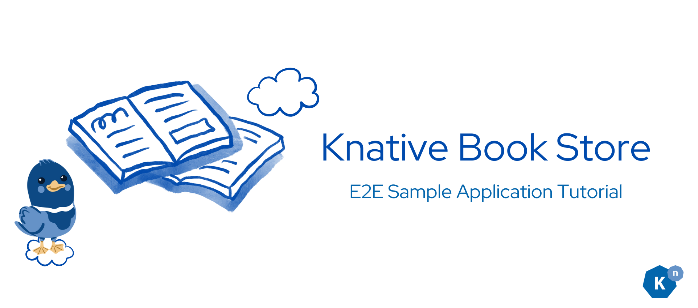
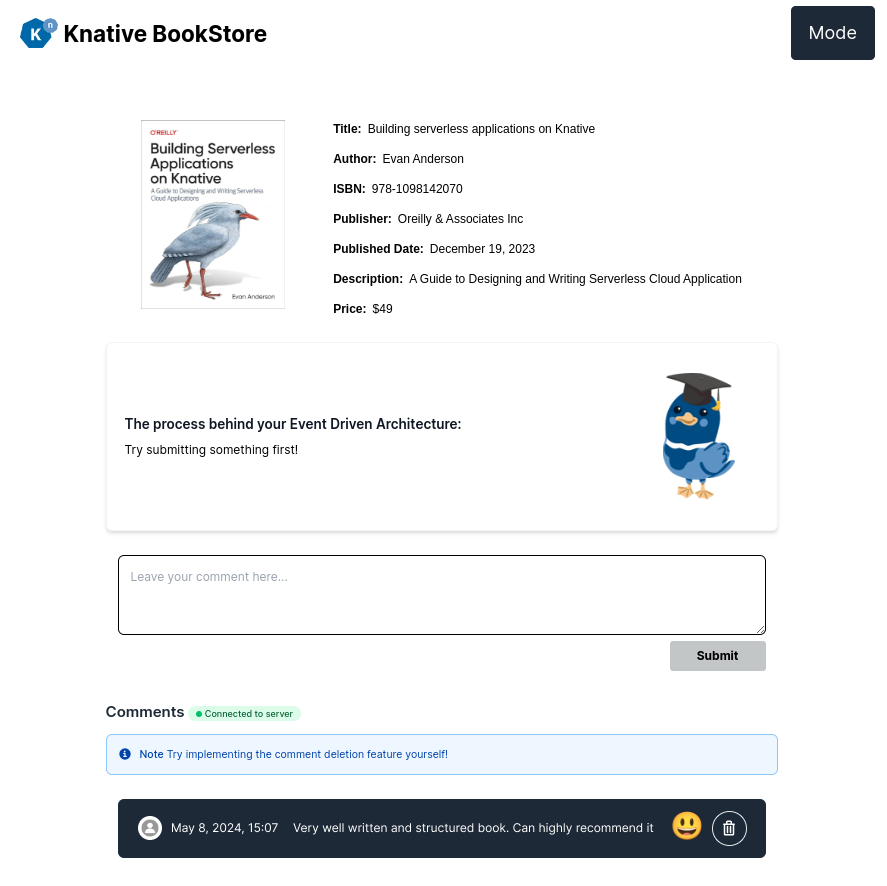
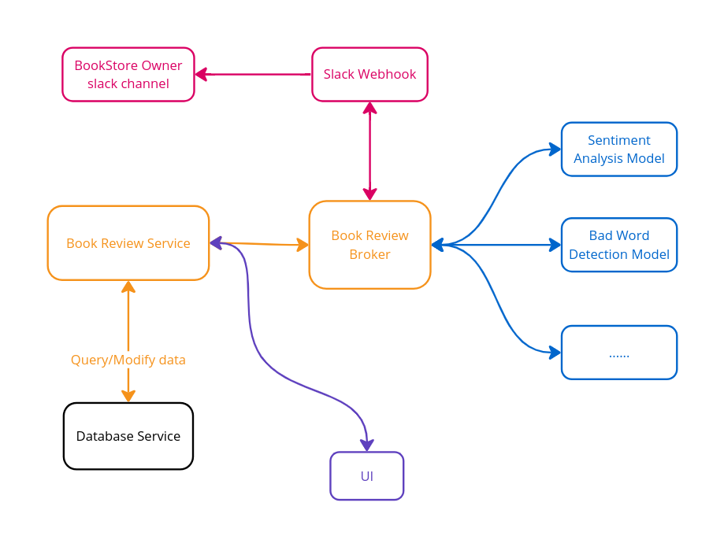

# Welcome: Knative Bookstore Tutorial

Build an educational bookstore sample **after the Knative basics**. Submit a review, observe its event-driven processing, and see an accepted review appear with a sentiment emoji.

If this is your first encounter with Knative, complete the [Quickstart Serving and Eventing route](../../getting-started/README.md) first. Bookstore combines several technologies; it is not production-application guidance. Its [disclaimer, third-party acknowledgments, and media licenses](../disclaimer/README.md) remain available throughout the tutorial.

## What are we building?

The bookstore displays a single book. Readers submit anonymous reviews. Two Python functions check for inappropriate language and classify sentiment; accepted reviews are stored in PostgreSQL and displayed in the frontend. Reviews classified as inappropriate are excluded from insertion and can still be inspected in the event-display logs. Classifier results are not guaranteed to be accurate.

**The core tutorial ends when you can submit a review and observe both its processed CloudEvent and its appearance in the UI.** Slack notifications are an optional extension.

## Learning Goal

You will:

- Connect a Kubernetes Deployment to a Broker using a SinkBinding.
- Inspect review CloudEvents with an event-display sink.
- Create and deploy two Knative Functions.
- Run those functions in order using a Sequence and return the processed event to the Broker.
- Filter processed events with a Trigger and send accepted reviews to the database API.

The exercise illustrates an event-driven design rather than a direct request chain between every component. It does not establish delivery guarantees, production readiness, or a general migration strategy for your application.

## Before you begin

- Complete the [Quickstart](../../getting-started/README.md), including requesting a Service and sending and receiving an event.
- Be comfortable applying YAML with `kubectl` and inspecting resource status and pod logs.
- Have Git, Docker, `kind`, `kubectl`, `kn`, and a browser available.
- Have a disposable kind cluster with Serving, Eventing, and InMemoryChannel support. You can reuse the Quickstart cluster if you have not cleaned it up.
- For the setup below, install and run kind's [LoadBalancer provider](https://kind.sigs.k8s.io/docs/user/loadbalancer/). Quickstart's Knative ingress does not by itself provide external addresses for the sample's two ordinary Kubernetes LoadBalancer Services.
- Before lesson 2, install `func` and have a container registry that you can push images to and that the cluster can pull from. Use public sample images unless you have configured private image pulls.

Use the `default` namespace: the sample backend's PostgreSQL address is hard-coded to that namespace. The [setup lesson](../page-0.5/environment-setup.md) establishes the working directory and verifies the frontend/backend connection.

## Bookstore Architecture

| Component | Role in this sample |
| --- | --- |
| [User interface](../page-0.5/environment-setup.md#task-2-running-the-bookstore-web-app) | Next.js frontend deployed as a Kubernetes Deployment. It proxies requests and WebSocket traffic to the review service. |
| [Book reviews service](../page-1/send-review-comment-to-broker.md#step-1-understand-book-review-service) | Node.js Deployment. `/add` forwards new review events to the Broker, `/insert` inserts processed reviews, and `/comments` streams database rows to the frontend. |
| [ML model services](../page-4/create-sequence-to-streamline-ML-workflows.md) | Two Knative Functions, called in order by a [Sequence](../../eventing/flows/sequence/README.md): inappropriate-language filter, then sentiment analysis. |
| [Bookstore Broker](../page-1/send-review-comment-to-broker.md#step-2-create-broker) | Receives review events; Triggers select subscribers for the original and processed event types. Delivery behavior depends on the installed implementation. |
| [Database service](../page-5/deploy-database-service.md) | PostgreSQL StatefulSet with a persistent volume claim and an initialization Job. This sample is not a production database setup. |
| [Notification service (optional)](../page-7/slack-sink-learning-knative-eventing-and-apache-camel-K-integration.md) | Apache Camel K Pipe that sends selected CloudEvents to a Slack webhook. |
| [Bad-word Broker (optional)](../page-7/slack-sink-learning-knative-eventing-and-apache-camel-K-integration.md#step-1-create-the-broker-that-can-route-bad-word-comments-to-slack) | Receives events selected by a Trigger before the Camel K Pipe sends them to Slack. |

## Tutorial Page Structure

### Core route — follow in order

0. [Environment setup](../page-0.5/environment-setup.md): deploy and access the frontend and review service.
1. [Send a review to the Broker](../page-1/send-review-comment-to-broker.md): connect the backend and observe a `new-review-comment` event.
2. [Deploy sentiment analysis](../page-2/sentiment-analysis-service-for-bookstore-reviews.md): create a Python function and verify its CloudEvent response.
3. [Deploy the inappropriate-language filter](../page-3/create-bad-word-filter-service.md): create and verify the second function.
4. [Connect the functions with a Sequence](../page-4/create-sequence-to-streamline-ML-workflows.md): observe a `moderated-comment` event returned to the Broker.
5. [Deploy the database](../page-5/deploy-database-service.md): initialize PostgreSQL and view the sample comments.
6. [Route accepted reviews to the database](../page-6/advanced-event-filtering.md): submit a review and observe the completed application.

### Optional extensions — after the core result

- [Slack/Camel K integration recipe](../page-7/slack-sink-learning-knative-eventing-and-apache-camel-K-integration.md): pending runtime validation of operator scope, namespaces, registry, and webhook delivery. This is supporting experimental configuration, not a verified executable lesson.
- [Extra challenges](../extra-challenge/README.md): open-ended exercises, including Telegram integration and comment deletion. Some require the notification extension.
- [Alternative setup notes](../page-0.5/setup-options.md): existing clusters, minikube, image builds, and the setup script.

## How to properly learn?

### Step-by-Step Guidance for Beginners

Follow the [core lessons in order](#core-route-follow-in-order) after Quickstart. Run each lesson's commands from the stated directory, and pass its verification before proceeding. Use the sample repository's `solution` directory to compare your work when stuck; do not deploy the whole solution over your partially completed exercise.

### Accelerated Learning Path for Advanced Users

Use the [architecture table](#bookstore-architecture) to jump to a component lesson or consult [setup alternatives](../page-0.5/setup-options.md). These are shortcuts to supporting detail, not permission to skip the starting-state and verification requirements of the core lessons.

### Preview the final Bookstore

The demo includes the optional Slack extension; you do not need to reproduce that branch to complete the core tutorial.

<iframe width="1924" height="500" src="https://www.youtube.com/embed/5D8pTcQSacw" title="Knative E2E Bookstore Tutorial - Demo" frameborder="0" allow="accelerometer; autoplay; clipboard-write; encrypted-media; gyroscope; picture-in-picture; web-share" referrerpolicy="strict-origin-when-cross-origin" allowfullscreen></iframe>

[Watch the demo on YouTube](https://www.youtube.com/watch?v=5D8pTcQSacw&ab_channel=Knative). See the [music and graphic licenses](../disclaimer/README.md#music-used-in-the-demo-video).

## Help

Ask questions in the CNCF Slack [#knative channel](https://cloud-native.slack.com/archives/C04LGHDR9K7). Search existing discussions first, and include the lesson, resource status, and relevant logs. Do not share registry credentials or Slack webhook URLs.

## Next Step

[Start environment setup :fontawesome-solid-paper-plane:](../page-0.5/environment-setup.md){ .md-button .md-button--primary }
