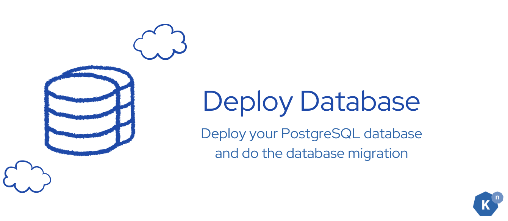
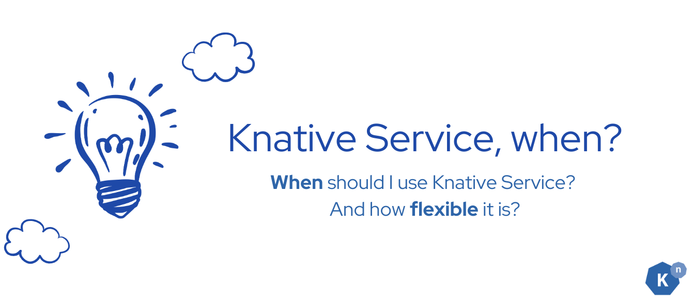
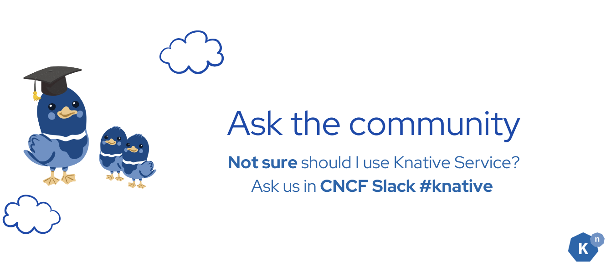
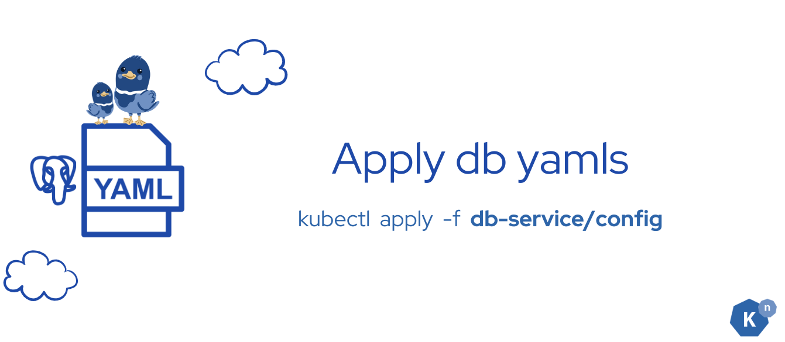
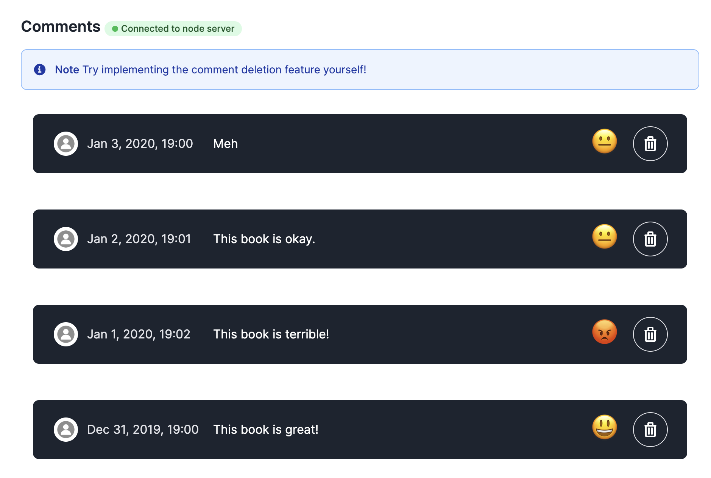

# **Deploy the Database Service**



**Starting state:** You have [observed the Sequence's processed event](../page-4/create-sequence-to-streamline-ML-workflows.md#verification). Your frontend and backend remain running. Run commands from `start` in `default`.

The supplied manifests use a persistent volume claim; this is **not an in-memory database**. Your disposable cluster must have storage that can bind that claim. Sample credentials and initialization data are for this exercise only.

## **What Knative features will we learn about?**

- What is a good usecase to use Knative Service

## **What does the final deliverable look like?**

- Running a PostgreSQL StatefulSet that contains the table and some sample data

## **Concept Learning**


**Knative Services** are a powerful feature within the Knative ecosystem, designed to handle a wide range of use cases, especially in modern cloud-native applications, it can be controlled by Knative Serving, and achieve scale to 0. Here's an expanded explanation of when and why you should consider using Knative Services:

???+ danger "Stateless Workloads"
    - **Definition:** Stateless applications do not store any data locally between requests. Each request is independent and does not rely on any previous interaction.
    - **Use Case:** Examples include web servers, APIs, and microservices where the state is managed externally, such as in a database or a cache.
    - **Benefits:** Simplifies scaling and failover because any instance can handle any request without requiring session persistence.

???+ example "Event-Driven Workloads"
    - **Definition:** Event-driven architectures respond to events or Triggers, such as HTTP requests, messages in a queue, or changes in a database.
    - **Use Case:** Use Knative Services to deploy functions that react to events, such as processing incoming data, triggering workflows, or integrating with third-party APIs.
    - **Benefits:** Services can release compute resources by scaling down to zero when idle. Scaling back up introduces startup latency; it does not guarantee improved performance.



Try to ask in the Knative Slack community [#knative](https://cloud-native.slack.com/archives/C04LGHDR9K7){:target="_blank"} whether it is the best use case or not.

## **Implementation**

### **Step 1: apply all the config yaml files**



In this section, we will just be simply running a PostgreSQL service. We have all config files ready. Simply run the following command to apply all yamls at once.

```sh
kubectl apply -f db-service
```

Wait for the database and initialization Job rather than continuing on persistent failures:

```sh
kubectl rollout status statefulset/postgresql --timeout=300s
kubectl wait --for=condition=complete job/postgresql-job --timeout=300s
```

The Job may retry while PostgreSQL starts. If either command times out, inspect `kubectl get pvc`, `kubectl describe job postgresql-job`, and `kubectl logs job/postgresql-job` before continuing. The supplied Job permits five retries and is automatically removed 50 seconds after finishing; if it has already disappeared, verify the seeded comments in the UI below.

???+ success "Verify"

    You should see the following output:
    ```
    configmap/sql-configmap created
    secret/postgresql-secret created
    persistentvolumeclaim/postgresql-pvc created
    statefulset.apps/postgresql created
    service/postgresql created
    job.batch/postgresql-job created
    ```

    The database initialization Job must complete successfully. Earlier failed attempt pods may remain temporarily; a failed Job is not a successful setup. This is illustrative output from a longer session (the optional Camel K operator is not required):

    ```
    NAME                                  READY   STATUS    RESTARTS   AGE
    bookstore-frontend-7b879ffb78-9bln6   1/1     Running   0          6h53m
    camel-k-operator-7989475884-7wk6z     1/1     Running   0          5h26m
    event-display-55967c745d-bxrgh        1/1     Running   0          5h26m
    node-server-644795d698-r9zlr          1/1     Running   0          5h26m
    postgresql-0                          1/1     Running   0          5h23m
    postgresql-job-55dlv                  0/1     Completed 0          10s
    postgresql-job-fnv8m                  0/1     Error     0          73s
    ```

## **Verification**


Get the IP address of the front end service as follows: `kubectl get svc -o=jsonpath='{.status.loadBalancer.ingress[0].ip}' bookstore-frontend-svc`

Open the UI page at `http://${IP}`, you should see some new comments popping up at the bottom of the page.

???+ bug "Troubleshoot: no comments appear"
    **“No comments available” is a symptom, not proof that database initialization failed.** Check the stages independently:

    1. **Storage or database not ready:** inspect `kubectl get pvc postgresql-pvc`, `kubectl describe pvc postgresql-pvc`, `kubectl get pods -l app=postgresql`, and `kubectl logs statefulset/postgresql`. A pending claim or database startup error must be resolved before checking initialization.
    2. **Initialization Job failed or still running:** inspect `kubectl get job postgresql-job`, `kubectl describe job postgresql-job`, and `kubectl logs job/postgresql-job`. Use its completion status and logs, not the UI label, as evidence. If the Job was removed by its TTL, absence alone proves neither success nor failure; inspect the database rows below. Do not reapply the seed Job blindly, since it inserts sample rows.
    3. **Backend cannot retrieve rows:** inspect `kubectl logs deployment/node-server` for connection or query errors. The supplied backend queries `book_reviews` in `mydatabase` at `postgresql.default.svc.cluster.local`. Check that the database, table, credentials, and namespace match the supplied manifests. In this sample, you can inspect the rows directly:

        ```sh
        kubectl exec postgresql-0 -- psql -U myuser -d mydatabase \
          -c 'SELECT id, content, sentiment FROM book_reviews ORDER BY post_time DESC;'
        ```

        Use the configured database credentials if PostgreSQL requests authentication; do not print or share the Secret. Rows in this query establish database contents independently of the UI.
    4. **Rows exist but the UI stays empty:** check the frontend's backend connection indicator, browser connection errors, and `kubectl logs deployment/bookstore-frontend`. The frontend uses a WebSocket connection to the backend's `/comments` endpoint; a disconnected or failing proxy path can hide initialized data. Return to [frontend/backend setup checks](../page-0.5/environment-setup.md#access-the-node-server-backend) rather than assuming the seed Job failed.

    Continue only after seeing the seeded comments in the connected UI. This checks initialization and the display path, not insertion of new review events.




## **Next Step**


You have successfully set up the database services, and it is ready to receive requests and store user comments.

Next, route accepted `moderated-comment` events to the backend's `/insert` endpoint. The seeded comments prove initialization; they do not yet prove that newly submitted reviews are stored.

**Previous:** [Create the Sequence](../page-4/create-sequence-to-streamline-ML-workflows.md) · **Next:** [Route accepted reviews](../page-6/advanced-event-filtering.md)

[Go to Implement Advanced Event Filtering :fontawesome-solid-paper-plane:](../page-6/advanced-event-filtering.md){ .md-button .md-button--primary }
