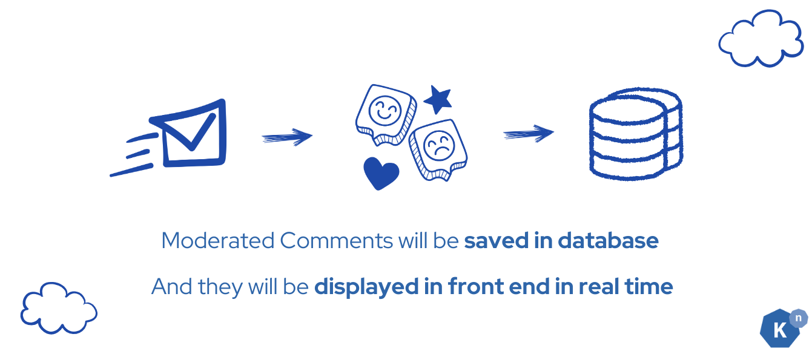
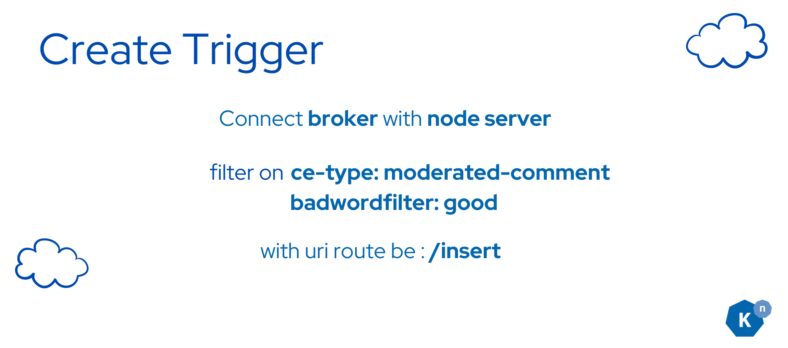
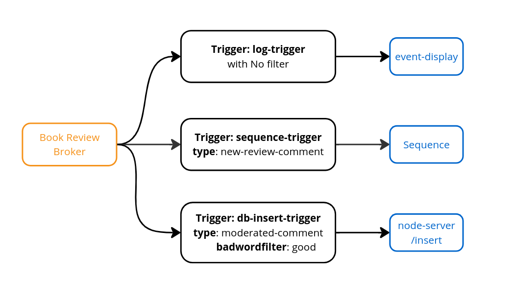

<span id="advanced-event-filtering"></span>

# Route accepted reviews to the database


## **What Knative features will we learn about?**

- Trigger and Broker
- Route events by their type and the `badwordfilter` extension

## **What does the final deliverable look like?**



- A Trigger routes processed events already returned to the Broker by the Sequence to the backend's `/insert` endpoint.
- The backend stores reviews with `type: moderated-comment` and `badwordfilter: good` in PostgreSQL.
- The comments that don't contain bad words will show up in the UI, and the sentiment will be displayed as emoji.

**Starting state:** You have [initialized PostgreSQL and seen its seeded comments](../page-5/deploy-database-service.md#verification). The Sequence returns `moderated-comment` events to `bookstore-broker`. Run commands from `start` in the same `default` namespace.

## **Implementation**

### **Step 1: Create the Trigger for database insertion**



Append the following Trigger configuration to the existing `node-server/config/200-broker.yaml` file and then apply:

???+ abstract "**Append** to _node-server/config/200-broker.yaml_"
    ```yaml 
    ---
    apiVersion: eventing.knative.dev/v1
    kind: Trigger
    metadata:
      name: db-insert-trigger
    spec:
      broker: bookstore-broker
      filter:
        attributes: # Trigger will filter events based on BOTH the type and badwordfilter attribute
          type: moderated-comment # This is the filter that will be applied to the event, only events with the ce-type moderated-comment will be processed
          badwordfilter: good # This is the filter that will be applied to the event, only events with the ce-extension badwordfilter: good will be processed
      subscriber:
        ref:
          apiVersion: v1
          kind: Service
          name: node-server-svc
        uri: /insert # This is the path where the event will be sent to the subscriber, see /insert in node-server code: index.js
    ```

```shell
kubectl apply -f node-server/config/200-broker.yaml
```

After applying the configuration, you should see

```
broker.eventing.knative.dev/bookstore-broker unchanged
trigger.eventing.knative.dev/db-insert-trigger created
```

So far, the Triggers you created in your cluster should look like the following:



???+ success "Verify"
    Run the following command to check if the Trigger is created successfully:

    ```shell
    kubectl get triggers
    ```

    You should see the Trigger in ready state:
    ```
    NAME                BROKER             SUBSCRIBER_URI                                                       AGE     READY   REASON
    db-insert-trigger   bookstore-broker   http://node-server-svc.default.svc.cluster.local/insert              5h32m   True
    sequence-trigger    bookstore-broker   http://sequence-kn-sequence-0-kn-channel.default.svc.cluster.local   5h30m   True
    log-trigger         bookstore-broker   http://event-display.default.svc.cluster.local                       5h32m   True
    ```


## **Verification**


Verify the whole core path with a new review:

1. Watch the event-display logs: `kubectl logs -l app=event-display -f`.
2. In the frontend, submit a distinctive review, for example `I love Knative so much — core tutorial test`.
3. Find its `moderated-comment` event in the logs. Inspect `badwordfilter` and `sentimentResult`; the classifier, not the human description of the text, determines routing.
4. If `badwordfilter` is `good`, confirm that this review appears in the UI with a sentiment emoji. You can also check `kubectl logs deployment/node-server` for `Review inserted:` followed by the review text.
5. For an event classified as `bad`, confirm it is logged but does not appear as a newly inserted review. Slack delivery is **not** configured by the core tutorial.

If a `good` processed event is logged but not displayed, check `kubectl describe trigger db-insert-trigger`, backend logs, and database readiness. Use [Events do not reach a subscriber](../../eventing/troubleshooting/events-not-delivered.md) for route/readiness/filter checks, or [Events repeatedly fail delivery](../../eventing/troubleshooting/delivery-failures.md) if you have a dispatch error. A Ready Trigger alone is not proof of successful insertion. Do not treat the sample's classifier as a reliable moderation system.

Stop the log watch with `Ctrl+C`. You have completed the core outcome: frontend → backend → Broker → Sequence → Broker → insertion Trigger → backend/database → frontend.

## **Next Step**


**The core Bookstore tutorial is complete.** You can stop here without installing another operator or creating a Slack account.

- [Clean up the disposable cluster](../../getting-started/clean-up.md) when finished. This deletes the sample workloads and database data.
- [Choose a Knative task or explanation](../../getting-started/next-steps.md) to apply what you learned.
- [Route matching events with a Trigger](../../eventing/triggers/README.md) for another workload, or [test retries and a dead-letter sink](../../eventing/event-delivery.md) in an isolated namespace. These are follow-on tasks, not additional core lessons.
- Optionally inspect the [Slack/Camel K integration recipe](../page-7/slack-sink-learning-knative-eventing-and-apache-camel-K-integration.md), which is pending runtime validation. It is not a required or verified next lesson.
- Try [extra challenges](../extra-challenge/README.md) if you prefer an open-ended exercise.

**Previous:** [Deploy the database](../page-5/deploy-database-service.md) · **Route:** [Bookstore overview](../page-0/welcome-knative-bookstore-tutorial.md)

[Optional: inspect the Slack/Camel K recipe](../page-7/slack-sink-learning-knative-eventing-and-apache-camel-K-integration.md){ .md-button }
