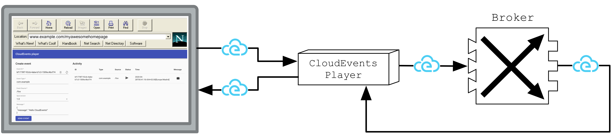
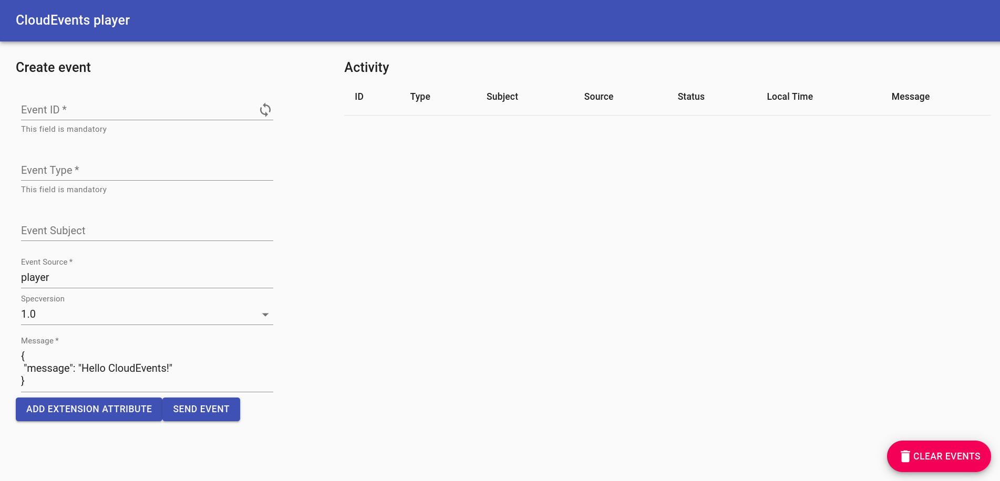
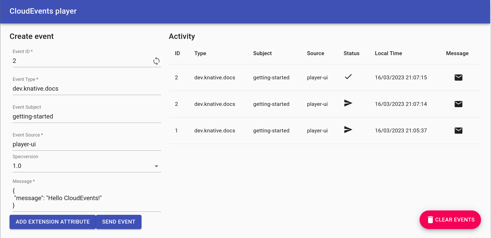

<span id="using-a-knative-service-as-a-source"></span>

# Send and receive an event

Start with the ready `example-broker` from the [previous page](getting-started-eventing.md).
You will use the CloudEvents Player as both an event producer and consumer:



<span id="creating-your-first-source"></span>

## Run the CloudEvents Player

Create a Service named `cloudevents-player` in your learning namespace:

```bash
kn service create cloudevents-player \
  --image quay.io/ruben/cloudevents-player:latest
```

Wait for the Service to become ready. Tell it where to send events by creating
a **SinkBinding** pointing at the Broker:

```bash
kn source binding create ce-player-binding \
  --subject "Service:serving.knative.dev/v1:cloudevents-player" \
  --sink broker:example-broker
```

The binding supplies the destination to the player. Wait for it to be ready:

```bash
kubectl wait sinkbinding/ce-player-binding --for=condition=Ready --timeout=120s
```

You do not need to look up or hard-code the Broker's internal URL.

## Connect the consumer

Create a Trigger that delivers events from the Broker back to the player:

```bash
kn trigger create cloudevents-trigger \
  --broker example-broker \
  --sink cloudevents-player
kn trigger list
```

Wait until `cloudevents-trigger` has `READY` set to `True`. With no filter, this
Trigger matches all events arriving at this Broker. Set up the consumer **before**
sending your test event; sending to a Broker alone does not establish a delivery path.

<span id="examining-the-cloudevents-player"></span>

## Open the player

Print the Service URL and open it in your browser:

```bash
kn service describe cloudevents-player -o url
```

The page contains a form for creating a CloudEvent:



### Sending an event

Fill in the form with these values, generating an Event ID if the form has not
already supplied one:

| Field | Value |
| --- | --- |
| Event ID | A unique ID; keep it so you can recognize this event |
| Event Type | `dev.knative.tutorial` |
| Event Source | `/tutorial` |
| Specversion | `1.0` |
| Message | `{"message":"Hello Eventing!"}` |

The Message field expects valid JSON. Click **SEND EVENT**. The player sends the
event to the Broker, which delivers it through your Trigger back to the player.

## Check the result

Look for the same Event ID in the player's sent and received event entries.
Confirm that the received event contains your type and message. A sent entry alone
is not proof of delivery; the received entry is the result you are looking for.



??? help "If you do not see a received event"

    Check `kn broker list`, `kn trigger list`, and `kn service list` for readiness.
    Refresh the browser view if needed. The
    [Eventing troubleshooting guide](../eventing/troubleshooting/README.md) provides
    further diagnostics.

## Choose your next step

You have routed an event from a producer to a consumer. You can now:

- [Filter events by type](first-trigger.md) — an optional extension to this lesson.
- [Continue learning](next-steps.md) with another component or your own application.
