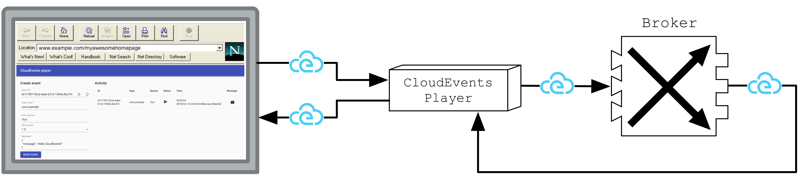
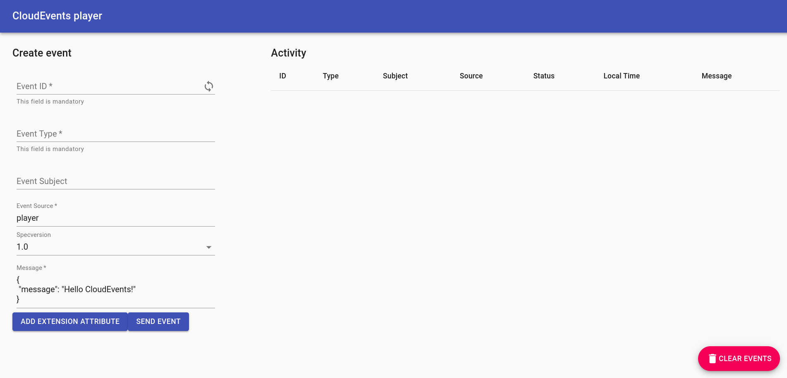
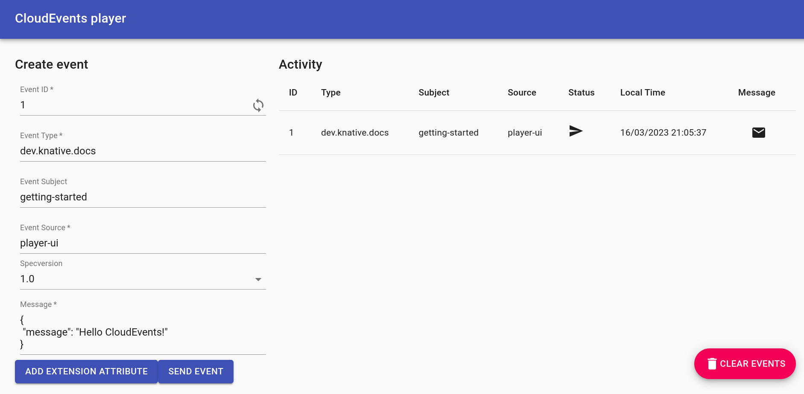
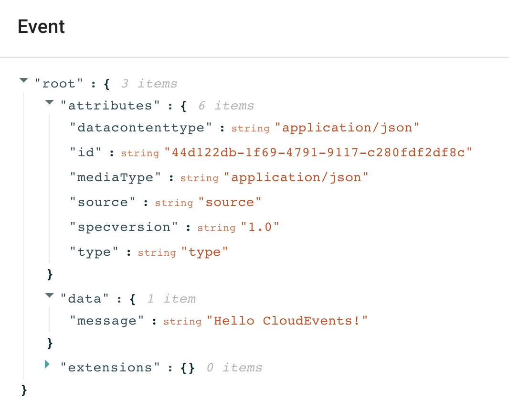

# Using a Knative Service as a source

**Starting state:** You have [verified `example-broker`](first-broker.md) on the Quickstart cluster in `default`. No Service named `cloudevents-player` or binding named `ce-player-binding` should already exist there.

In this tutorial, you will use the [CloudEvents Player](https://github.com/ruromero/cloudevents-player){target=blank} app to showcase the core concepts of Knative Eventing. By the end of this tutorial, you should have an architecture that looks like this:



The above image is Figure 6.6 from [Knative in Action](https://www.manning.com/books/knative-in-action){target=_blank}.

## Creating your first source

The CloudEvents Player acts as a Source for CloudEvents by intaking the name of the Broker as an environment variable, `BROKER_NAME`. If the Broker is
located in a different namespace it is possible to also set the `BROKER_NAMESPACE` environment variable. Alternatively, you can just use the `BROKER_URI`.

You will send CloudEvents to the Broker through the CloudEvents Player application.

Create the CloudEvents Player Service:

```bash
kn service create cloudevents-player \
  --image quay.io/ruben/cloudevents-player:latest
```

!!! success "Expected result"
    The Service becomes available and `kn` prints its URL.

The service is now running but it doesn't know where the broker is so let's create a
[SinkBinding](https://knative.dev/docs/eventing/custom-event-source/sinkbinding/) between the service and the broker.

```bash
kn source binding create ce-player-binding \
  --subject "Service:serving.knative.dev/v1:cloudevents-player" \
  --sink broker:example-broker
kubectl get sinkbinding ce-player-binding
```

!!! success "Expected result"
    The binding is created in `default`. Wait until its `READY` column is `True` before sending an event.

??? info "YAML equivalents (not needed for this route)"
    See the [Player Service and SinkBinding examples](yaml-examples.md#create-the-cloudevents-player).

## Examining the CloudEvents Player

**You can use the CloudEvents Player to send and receive CloudEvents.**
If you open the Service URL in your browser, the **Create Event** form appears.

Get the Service URL from your cluster:

```bash
kn service describe cloudevents-player -o url
```

For kind Quickstart it resembles `http://cloudevents-player.default.127.0.0.1.sslip.io`. Open the reported URL.



??? question "What do these fields mean?"
    | Field          | Description |
    |:----------------:|:-------------|
    | `Event ID`     | A unique ID. Click the loop icon to generate a new one.   |
    | `Event Type`   | An event type.|
    | `Event Source` | An event source.|
    | `Specversion`  | Demarcates which CloudEvents spec you're using (should always be 1.0).|
    | `Message`      | The `data` section of the CloudEvent, a payload which is carrying the data you care to be delivered.|

    For more information on the CloudEvents Specification, check out the [CloudEvents Spec](https://github.com/cloudevents/spec/blob/v1.0.1/spec.md){target=_blank}.

### Sending an event

Try sending an event using the CloudEvents Player interface:

1. Fill in the form with whatever data you want.
1. Ensure your Event Source does not contain any spaces.
1. Click **SEND EVENT**.



??? tip "Clicking the :fontawesome-solid-envelope: shows you the CloudEvent as the Broker sees it."
    {:width="500px"}

??? question "Want to send events using the command line instead?"
    Use `POST /messages` to ask the Player to **send** an event to its configured sink, as the Web form does. `POST /` is the Player's **subscriber/receive** endpoint; posting there tests only receipt by the Player and bypasses the Broker/Trigger path.

    To send an event through the source endpoint:
    ```bash
    curl -i "$(kn service describe cloudevents-player -o url)/messages" \
        -H "Content-Type: application/json" \
        -H "Ce-Id: 123456789" \
        -H "Ce-Specversion: 1.0" \
        -H "Ce-Type: some-type" \
        -H "Ce-Source: command-line" \
        -d '{"msg":"Hello CloudEvents!"}'
    ```

    Use a new `Ce-Id` for each test. To view the Player's recorded sent/received entries:
    ```bash
    curl "$(kn service describe cloudevents-player -o url)/messages"
    ```

The :material-send: icon in the "Status" column implies that the event has been sent to our Broker... but where has the event gone? **Well, right now, nowhere!**

There is not yet a Trigger routing these events to a subscriber. In the next lesson, create one, then send a **new** event to observe delivery.

**Previous:** [Inspect the Broker](first-broker.md) · **Next:** [Receive events with a Trigger](first-trigger.md)
