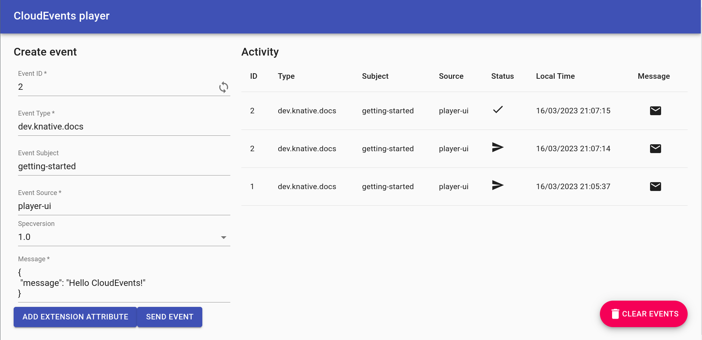

# Using Triggers and sinks

In the last topic we used the CloudEvents Player as an event source to send events to the Broker.
We now want the event to go from the Broker to an event sink.

In this topic, we will use the CloudEvents Player as the sink as well as a source.
This means we will be using the CloudEvents Player to both send and receive events.
We will use a Trigger to listen for events in the Broker to send to the sink.

## Creating your first Trigger

Create a Trigger that listens for CloudEvents from the event source and places them into the sink, which is also the CloudEvents Player app.

Use the same Quickstart cluster and `default` namespace as in [the source lesson](first-source.md).

```bash
kn trigger create cloudevents-trigger \
  --sink cloudevents-player --broker example-broker
kubectl get trigger cloudevents-trigger
```

!!! success "Expected result"
    The Trigger is created in `default`. Wait for `READY` to be `True` before sending another event.

??? info "YAML equivalent (not needed for this route)"
    See [route Broker events back to the Player](yaml-examples.md#route-broker-events-back-to-the-player).

??? question "What CloudEvents is my Trigger listening for?"
    Because we didn't specify a `--filter` in our `kn` command, the Trigger is listening for any CloudEvents coming into the Broker.

    Expand the next note to see how to use Filters.

Now, when we go back to the CloudEvents Player and send an event, we see that CloudEvents are both sent and received by the CloudEvents Player:

{draggable=false}

You may need to refresh the page to see your changes.

??? question "What if I want to filter on CloudEvent attributes?"
    First, delete your existing Trigger:
    ```bash
      kn trigger delete cloudevents-trigger
    ```
    Now let's add a Trigger that listens for a certain CloudEvent Type
    ```bash
      kn trigger create cloudevents-player-filter --sink cloudevents-player  --broker example-broker --filter type=some-type
    ```

    If you send a CloudEvent with type `some-type`, it is reflected in the CloudEvents Player UI.  The Trigger ignores any other types.

    This example matches the CloudEvent `type` attribute, not fields inside its data payload. See the [Trigger filtering reference](../eventing/triggers/reference.md) for filtering details.


You have now observed a complete event path: Player → Broker → Trigger → Player. The sent and received entries show the two sides of that path.

For your own workloads, [route matching events with a Trigger](../eventing/triggers/README.md), or [configure retries and a dead-letter sink in an isolated test](../eventing/event-delivery.md). If delivery is not working, start with [events not reaching a subscriber](../eventing/troubleshooting/events-not-delivered.md) or [repeated delivery failures](../eventing/troubleshooting/delivery-failures.md), according to the evidence you have.

**Previous:** [Send an event](first-source.md) · **Next:** [Choose your next step](next-steps.md)

Finished experimenting? [Clean up the disposable cluster](clean-up.md).
