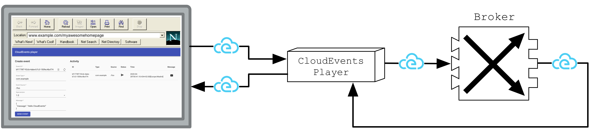

<span id="knative-eventing"></span><span id="your-first-event"></span><span id="explore-the-broker"></span>

# Try Eventing

Send a CloudEvent through a **Broker** and use a **Trigger** to deliver it to a
consumer (sink). The CloudEvents Player acts as both sender and consumer so you
can observe delivery without writing code.

<span id="before-you-begin"></span>

## Prepare

1. [Set up a cluster](quickstart-install.md) if you have not already done so,
   then return here with the `kind-knative` context and `default` namespace.

1. Confirm that the learning Broker (`example-broker`) is ready:

    ```bash
    kn broker list
    ```

    `example-broker` should show `READY=True`. This in-memory Broker is for
    learning, not production durability.

??? help "If the Broker is missing or not ready"

    Verify your [learning context](quickstart-install.md#create-and-verify),
    then inspect `kn broker describe example-broker`. If the Broker is missing,
    Quickstart setup did not finish cleanly.

<span id="using-a-knative-service-as-a-source"></span><span id="creating-your-first-source"></span>

## Connect the player

[](images/event_diagram.png){ .diagram-link }

1. Deploy the CloudEvents Player as a Knative Service:

    ```bash
    kn service create cloudevents-player \
      --image quay.io/ruben/cloudevents-player:latest
    ```

1. Create a **SinkBinding** so the player knows to send events to `example-broker`,
   and wait until it is ready:

    ```bash
    kn source binding create ce-player-binding \
      --subject "Service:serving.knative.dev/v1:cloudevents-player" \
      --sink broker:example-broker
    kubectl wait sinkbinding/ce-player-binding \
      --for=condition=Ready --timeout=120s
    ```

1. Create a **Trigger** that delivers all events from `example-broker` back to
   `cloudevents-player`, and wait for `READY=True`:

    ```bash
    kn trigger create cloudevents-trigger \
      --broker example-broker \
      --sink cloudevents-player
    kn trigger list
    ```

    Connect the consumer before sending an event — a Broker alone does not
    establish a delivery path.

<span id="examining-the-cloudevents-player"></span><span id="sending-an-event"></span><span id="check-the-result"></span>

## Send and receive

1. Print the player URL and open it in your browser:

    ```bash
    kn service describe cloudevents-player -o url
    ```

1. Fill in the **CloudEvent** form (leave Event Subject blank and keep the
   preset Specversion). A CloudEvent pairs JSON data with standard attributes
   such as `type` (a label for filtering) and `source` (the producer identifier):

    | Field | Value |
    | --- | --- |
    | Event ID | `tutorial-1` (or another unused ID) |
    | Event Type | `dev.knative.tutorial` |
    | Event Source | `/tutorial` |
    | Specversion | `1.0` |
    | Message | `{"message":"Hello Eventing!"}` |

    Click **SEND EVENT** (Message must be valid JSON).

1. Check the **Activity** table for **two** entries with the same Event ID:

    | Status | Event ID | Event Type |
    | --- | --- | --- |
    | Sent — outgoing arrow | `tutorial-1` | `dev.knative.tutorial` |
    | Received — checkmark | `tutorial-1` | `dev.knative.tutorial` |

    Click the envelope icon in **Message** on the received row and confirm
    `id`, `type`, and `data.message` (`Hello Eventing!`). A sent row alone is
    not proof of delivery.

??? help "If you do not see a received event"

    Refresh the browser, then check readiness of all four resources:

    ```bash
    kn broker list
    kn service list
    kn trigger list
    kubectl get sinkbinding ce-player-binding
    ```

    Describe any resource that is not ready (`kn broker describe example-broker`,
    `kn service describe cloudevents-player`, `kn trigger describe cloudevents-trigger`,
    `kubectl describe sinkbinding ce-player-binding`), or [get help](next-steps.md#get-help).
    Do not apply the separate example from the advanced
    [Eventing troubleshooting guide](../eventing/troubleshooting/README.md) just
    to repeat these checks.

<span id="using-triggers-and-sinks"></span><span id="creating-your-first-trigger"></span>

## Filter events (optional)

Narrow `cloudevents-trigger` so it delivers only events of type
`dev.knative.tutorial`:

1. Add the type filter and confirm `READY=True`:

    ```bash
    kn trigger update cloudevents-trigger --filter type=dev.knative.tutorial
    kn trigger list
    ```

1. In the player form, send two events with fresh Event IDs:
    - Type `dev.knative.tutorial` → appears as both **sent** and **received**.
    - Type `dev.knative.other` → appears only as **sent** (ignored by the Trigger).

1. Remove the filter to restore delivery of all event types, wait for readiness,
   and confirm a new `dev.knative.other` event is now received:

    ```bash
    kn trigger update cloudevents-trigger --filter type-
    ```

## Next steps

Keep your cluster if you want to try another track. Continue with
[Try Serving](first-service.md), [Try Functions](about-knative-functions.md),
or [Next steps and cleanup](next-steps.md).
