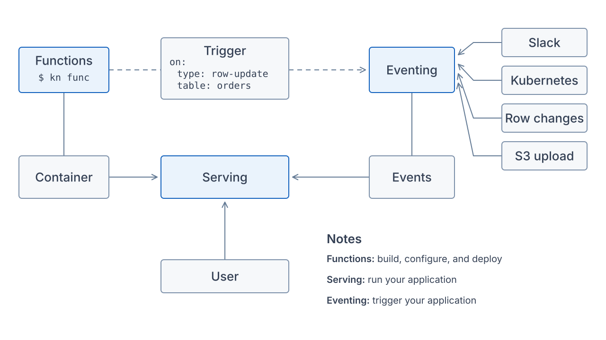
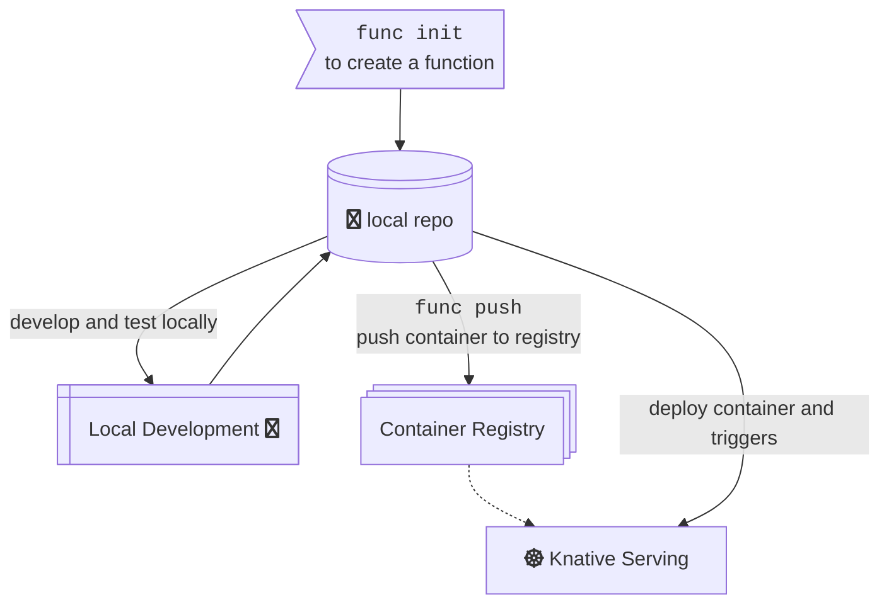

# Knative Technical Overview

This page explains how Knative's components work under the hood and integrate
with Kubernetes. For a high-level summary and hands-on tutorials, start at
[Get started with Knative](README.md).

## Architecture Overview

Knative consists of three main components that work together to provide a complete serverless platform:

[{draggable=false}](../images/home-images/knative_flowchart_graphic.svg){.diagram-link}

- **Knative Serving**: An HTTP-triggered autoscaling container runtime that manages the complete lifecycle of stateless HTTP services, including deployment, routing, and automatic scaling.
- **Knative Eventing**: A CloudEvents-over-HTTP asynchronous routing layer that provides infrastructure for consuming and producing events, enabling loose coupling between event producers and consumers.
- **Knative Functions**: A developer-focused function framework that leverages Serving and Eventing components to provide a simplified experience for building and deploying stateless functions.

These components can be used independently or together, allowing you to adopt Knative incrementally based on your needs.

## Knative Serving

--8<-- "about-serving.md"

### Request Flow in Serving

{draggable=false}

When a request is made to a Knative Service:

1. **Ingress Layer**: The request enters through the configured networking layer (Kourier, Istio, or Contour).
2. **Routing Decision**: Based on current traffic patterns and scaling state, requests are routed either to the Activator or directly to application pods.
3. **Scaling**: If no pods are running (scale-to-zero), the Activator queues the request and signals the Autoscaler to create pods.
4. **Queue-Proxy**: All requests pass through the Queue-Proxy sidecar, which enforces concurrency limits and collects metrics.
5. **Application**: The request reaches your application container.

For more detail, see the [request flow documentation](serving/request-flow.md).

### GPU Resources and LLM Inference

Because Knative Services run as Kubernetes pods, they can request GPU resources
through standard Kubernetes resource specifications while keeping scale-to-zero
and traffic splitting. For production LLM serving, consider
[KServe](https://kserve.github.io), which builds on Knative
Serving to add standardized inference protocols, multi-framework runtimes, and
request batching.

## Knative Eventing

--8<-- "about-eventing.md"

### Key Eventing Concepts

- **Event Sources**: Generate CloudEvents from external systems (databases, message queues, cloud services) and send them into the event mesh.
- **Brokers**: Receive events from sources and forward them to matching consumers based on CloudEvent attributes.
- **Triggers**: Filter events on a Broker by CloudEvent attributes and route matches to a subscriber.
- **Sinks**: Consumers that receive and process events — Knative Services, Kubernetes Services, or external HTTP endpoints.
- **Channels**: Lower-level primitives for point-to-point event delivery between producers and consumers.

### Event Flow in Eventing

{draggable=false}

1. **Event Generation**: An event source detects a change or condition and creates a CloudEvent.
2. **Event Ingestion**: The event is sent to a Broker via HTTP POST.
3. **Event Routing**: The Broker evaluates Triggers to determine which consumers should receive the event.
4. **Event Delivery**: The event is delivered to matching consumers as HTTP requests.
5. **Event Processing**: Consumers process the event and optionally produce response events.

## Knative Functions

--8<-- "about-functions.md"

### Functions Development Model

- **Standard signatures**: Functions use standard HTTP and CloudEvents interfaces to avoid lock-in.
- **Built-in templates**: Language packs provide templates for Node.js, TypeScript, Python, Go, and Java (Spring Boot and Quarkus), and you can author custom language packs.
- **Local development**: Build, run, and test locally with `func` before deploying.
- **Automatic containerization**: `func` builds OCI images without requiring a Dockerfile, and deploys them as Knative Services (or any container runtime).

### Function Deployment and Lifecycle

## Integration with Kubernetes

While each component can be used independently, they compose cleanly: Functions
deploy as Knative Services, Functions and Serving Services can act as event
sources or sinks, and all resources follow Kubernetes-native patterns.

- **Policy and IAM**: Serving and Eventing are Kubernetes CRDs, so standard RBAC, policies, and service accounts apply.
- **Networking**: Integrates with cert-manager, Gateway API, Istio, Kourier, and Contour.
- **Observability**: Uses [OpenTelemetry](https://opentelemetry.io/) to integrate with Prometheus, Grafana, Jaeger, and other backends.
- **CI/CD**: Compatible with GitOps workflows, Tekton Pipelines, and other continuous delivery tools.
